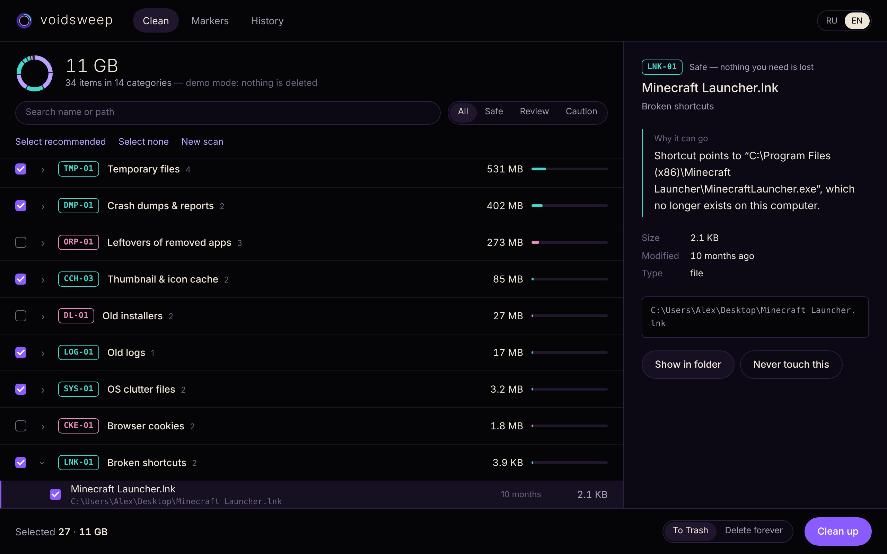

<p align="center">
  <a href="https://github.com/versex-arch/voidsweep">
    <picture>
      <source media="(prefers-color-scheme: dark)" srcset="docs/images/logo-dark.png">
      
    </picture>
  </a>
  <br>
  <span>Find junk on every drive of Windows, macOS and Linux, see why each file can go, and remove only what you approve</span>
  <br>
</p>

<p align="center">
  <a href="#installation">Installation</a>
  &nbsp;&nbsp;&nbsp;•&nbsp;&nbsp;&nbsp;
  <a href="#usage">Usage</a>
  &nbsp;&nbsp;&nbsp;•&nbsp;&nbsp;&nbsp;
  <a href="docs/usage.md">Documentation</a>
  &nbsp;&nbsp;&nbsp;•&nbsp;&nbsp;&nbsp;
  <a href="CONTRIBUTING.md">Contributing</a>
  &nbsp;&nbsp;&nbsp;•&nbsp;&nbsp;&nbsp;
  <a href="README.ru.md">Русский</a>
</p>

<p align="center">
  <a href="https://github.com/versex-arch/voidsweep/actions/workflows/ci.yml"></a>
  
  
  <a href="LICENSE"></a>
</p>

<p align="center">
  <a href="docs/images/demo.png"></a>
</p>

## Installation

| Method | Notes |
|---|---|
| [Releases](https://github.com/versex-arch/voidsweep/releases) | Ready-made `Voidsweep-windows.zip`, `Voidsweep-macos.zip`, `Voidsweep-linux.tar.gz`. Unzip and run |
| `pipx install "voidsweep[window] @ git+https://github.com/versex-arch/voidsweep"` | `pip` or `uv tool install` may be used in place of `pipx` |
| `git clone https://github.com/versex-arch/voidsweep && cd voidsweep && pip install .` | From source |

Requires Python 3.9+. No dependencies: the standard library is enough. The optional `[window]` extra adds a native
window through pywebview; without it voidsweep opens in an app-style Edge/Chrome window or your default browser.

> [!NOTE]
> The release builds are not code-signed yet. Windows SmartScreen: *More info → Run anyway*.
> macOS: right-click the app → *Open*.

## Usage

**Open the window**
```console
voidsweep
```

**See what can be removed, with a reason for every item**
```console
voidsweep scan -v
```

**Also walk every drive for Thumbs.db, .DS_Store, stray *.tmp and broken downloads**
```console
voidsweep scan --deep
```

**Clean chosen markers (asks first, uses the Trash)**
```console
voidsweep clean -m TMP-01 -m CCH-02
```

**Try the interface on sample data, nothing is touched**
```console
voidsweep --demo
```

```console
$ voidsweep --help
usage: voidsweep [-h] [--version] [--demo] [--browser] [--port PORT] {scan,clean,markers} ...

voidsweep v0.1.0: find junk on every drive, explain each item, remove only what you approve.

positional arguments:
  {scan,clean,markers}
    scan                show what can be removed and why
    clean               remove items of the chosen markers
    markers             explain marker codes

options:
  -h, --help            show this help message and exit
  --version             show program's version number and exit
  --demo                open the window with sample data
  --browser             use the default browser, not a window
  --port PORT           local port for the interface (default: random)

Without a command the window opens. Removal goes to the Trash unless --permanent is given.
Exit codes: 0 = done, 1 = cancelled at the prompt, 2 = usage error, 3 = some items were skipped.
Run `voidsweep markers` to see what every marker code means.
```

The full reference (every marker code and where it looks on each OS, the safety model, JSON output, how the
interface is protected, adding your own rules, limitations) is in **[docs/usage.md](docs/usage.md)**.

## What it finds

| | |
|---|---|
| 🗑️ **Temp** | `TMP-01` temp folders · `TMP-02` stray `*.tmp`, Office `~$` locks, abandoned `.crdownload` / `.part` |
| 🧊 **Cache** | `CCH-01` apps, Electron, GPU shaders · `CCH-02` Chrome, Edge, Firefox, Brave, Opera, Vivaldi, Yandex, Safari · `CCH-03` thumbnails · `CCH-04` pip, npm, yarn, Homebrew, Go, Cargo, NuGet |
| 👻 **Leftovers** | `ORP-01` data folders of uninstalled apps · `UPD-01` downloaded update packages · `DL-01` old installers in Downloads |
| 🔗 **Broken links** | `LNK-01` shortcuts and launchers whose program is gone · `LNK-02` dangling symlinks |
| 🧾 **Logs & dumps** | `LOG-01` stale logs · `DMP-01` crash dumps and error reports |
| 🍪 **Privacy** | `CKE-01` browser cookies (never preselected, signs you out) |
| 🧹 **OS clutter** | `SYS-01` `Thumbs.db`, `.DS_Store`, orphaned `._*` files on USB sticks |

Every code has a risk level: **safe** and **review** items are preselected, **caution** items never are.
Each item says in plain words why it can go, for example: *"Shortcut points to `C:\Program Files\Skype\Skype.exe`,
which no longer exists on this computer."*

## Disclaimer

```
voidsweep removes files only after you review the list and confirm,
and by default moves them to the Trash / Recycle Bin so they can be
restored. Protected locations (system folders, your documents,
keychains, backups) are never offered. Leftover detection (ORP-01)
is a heuristic: check those items before removing them.
The software is provided as is, without warranty of any kind.
```

## License

MIT © [versex-arch](https://github.com/versex-arch). See [LICENSE](LICENSE) and [SECURITY.md](SECURITY.md).
