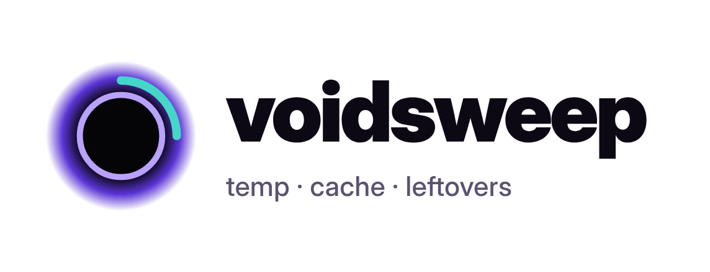
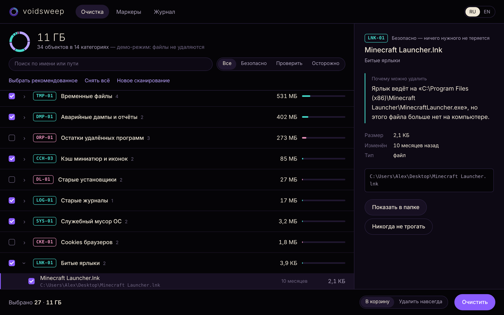

<p align="center">
  <a href="https://github.com/versex-arch/voidsweep">
    <picture>
      <source media="(prefers-color-scheme: dark)" srcset="docs/images/logo-dark.png">
      
    </picture>
  </a>
  <br>
  <span>Поиск мусора на всех дисках Windows, macOS и Linux: у каждого файла написано, почему его можно удалить, а удаляется только то, что вы одобрили</span>
  <br>
</p>

<p align="center">
  <a href="#установка">Установка</a>
  &nbsp;&nbsp;&nbsp;•&nbsp;&nbsp;&nbsp;
  <a href="#использование">Использование</a>
  &nbsp;&nbsp;&nbsp;•&nbsp;&nbsp;&nbsp;
  <a href="docs/usage.ru.md">Документация</a>
  &nbsp;&nbsp;&nbsp;•&nbsp;&nbsp;&nbsp;
  <a href="CONTRIBUTING.md">Участие</a>
  &nbsp;&nbsp;&nbsp;•&nbsp;&nbsp;&nbsp;
  <a href="README.md">English</a>
</p>

<p align="center">
  <a href="https://github.com/versex-arch/voidsweep/actions/workflows/ci.yml"></a>
  
  
  <a href="LICENSE"></a>
</p>

<p align="center">
  <a href="docs/images/demo-ru.png"></a>
</p>

## Установка

| Способ | Примечание |
|---|---|
| [Releases](https://github.com/versex-arch/voidsweep/releases) | Готовые `Voidsweep-windows.zip`, `Voidsweep-macos.zip`, `Voidsweep-linux.tar.gz`. Распакуйте и запустите |
| `pipx install "voidsweep[window] @ git+https://github.com/versex-arch/voidsweep"` | Вместо `pipx` можно `pip` или `uv tool install` |
| `git clone https://github.com/versex-arch/voidsweep && cd voidsweep && pip install .` | Из исходников |

Нужен Python 3.9+. Зависимостей нет — хватает стандартной библиотеки. Необязательное дополнение `[window]` даёт
нативное окно через pywebview; без него voidsweep откроется в окне-приложении Edge/Chrome или в браузере по умолчанию.

> [!NOTE]
> Готовые сборки пока не подписаны. Windows SmartScreen: *Подробнее → Выполнить в любом случае*.
> macOS: правый клик по приложению → *Открыть*.

## Использование

**Открыть окно программы**
```console
voidsweep
```

**Посмотреть, что можно удалить, с причиной для каждого файла**
```console
voidsweep scan -v --lang ru
```

**Дополнительно обойти все диски: Thumbs.db, .DS_Store, забытые *.tmp, брошенные загрузки**
```console
voidsweep scan --deep
```

**Очистить выбранные маркеры (сначала спросит, удаляет в корзину)**
```console
voidsweep clean -m TMP-01 -m CCH-02
```

**Посмотреть интерфейс на примерных данных — ничего не трогается**
```console
voidsweep --demo
```

```console
$ voidsweep --help
usage: voidsweep [-h] [--version] [--demo] [--browser] [--port PORT] {scan,clean,markers} ...

voidsweep v0.1.0: find junk on every drive, explain each item, remove only what you approve.

positional arguments:
  {scan,clean,markers}
    scan                show what can be removed and why
    clean               remove items of the chosen markers
    markers             explain marker codes

options:
  -h, --help            show this help message and exit
  --version             show program's version number and exit
  --demo                open the window with sample data
  --browser             use the default browser, not a window
  --port PORT           local port for the interface (default: random)

Without a command the window opens. Removal goes to the Trash unless --permanent is given.
Exit codes: 0 = done, 1 = cancelled at the prompt, 2 = usage error, 3 = some items were skipped.
Run `voidsweep markers` to see what every marker code means.
```

Полный справочник (все коды-маркеры и где они ищут на каждой ОС, модель безопасности, JSON-вывод, как защищён
интерфейс, как добавить своё правило, ограничения) — в **[docs/usage.ru.md](docs/usage.ru.md)**.

## Что находит

| | |
|---|---|
| 🗑️ **Временное** | `TMP-01` временные папки · `TMP-02` забытые `*.tmp`, блокировки Office `~$`, брошенные `.crdownload` / `.part` |
| 🧊 **Кэш** | `CCH-01` приложения, Electron, шейдеры видеокарты · `CCH-02` Chrome, Edge, Firefox, Brave, Opera, Vivaldi, Яндекс, Safari · `CCH-03` миниатюры · `CCH-04` pip, npm, yarn, Homebrew, Go, Cargo, NuGet |
| 👻 **Остатки** | `ORP-01` папки данных удалённых программ · `UPD-01` скачанные обновления · `DL-01` старые установщики в Загрузках |
| 🔗 **Битые ссылки** | `LNK-01` ярлыки, чья программа удалена · `LNK-02` битые символические ссылки |
| 🧾 **Логи и дампы** | `LOG-01` старые логи · `DMP-01` аварийные дампы и отчёты об ошибках |
| 🍪 **Приватность** | `CKE-01` cookies браузеров (никогда не выбраны заранее — вы выйдете из аккаунтов) |
| 🧹 **Мусор ОС** | `SYS-01` `Thumbs.db`, `.DS_Store`, «осиротевшие» файлы `._*` на флешках |

У каждого кода есть уровень риска: **безопасно** и **проверить** выбраны заранее, **осторожно** — никогда.
Каждый объект объясняет простыми словами, почему его можно удалить, например: *«Ярлык ведёт на
`C:\Program Files\Skype\Skype.exe`, но этого файла больше нет на компьютере.»*

## Отказ от ответственности

```
voidsweep удаляет файлы только после того, как вы просмотрели список
и подтвердили, и по умолчанию перемещает их в корзину, откуда их
можно восстановить. Защищённые места (системные папки, ваши
документы, связки ключей, резервные копии) никогда не предлагаются.
Поиск остатков программ (ORP-01) — эвристика: проверяйте такие
объекты перед удалением. Программа предоставляется «как есть», без
каких-либо гарантий.
```

## Лицензия

MIT © [versex-arch](https://github.com/versex-arch). См. [LICENSE](LICENSE) и [SECURITY.md](SECURITY.md).
